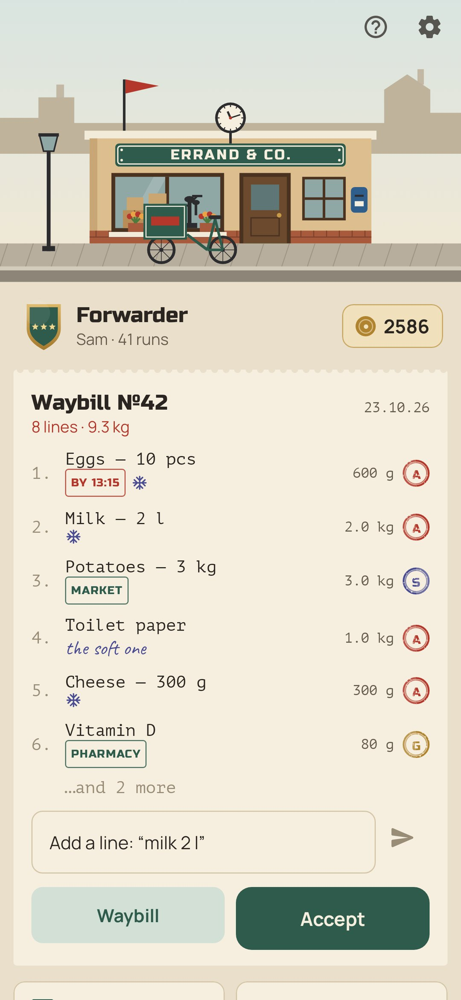
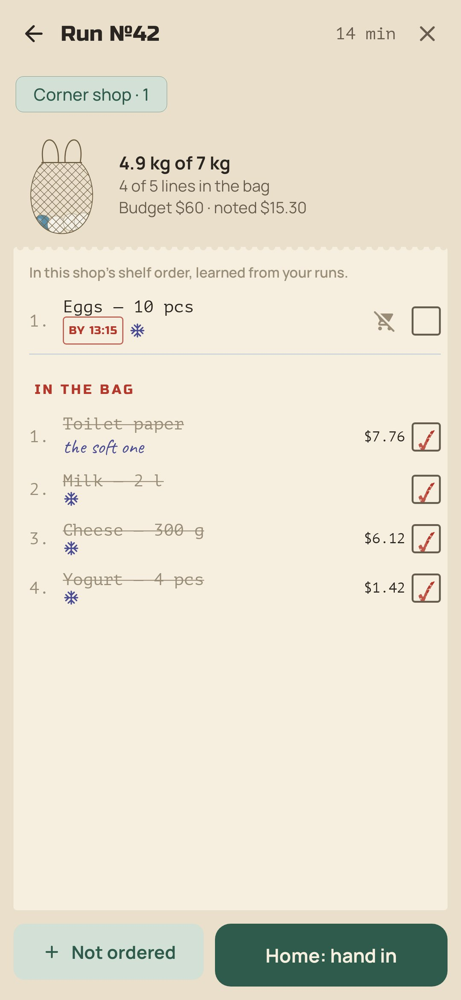
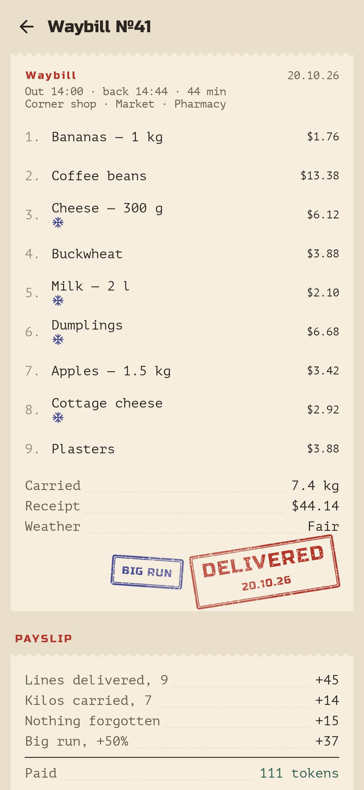
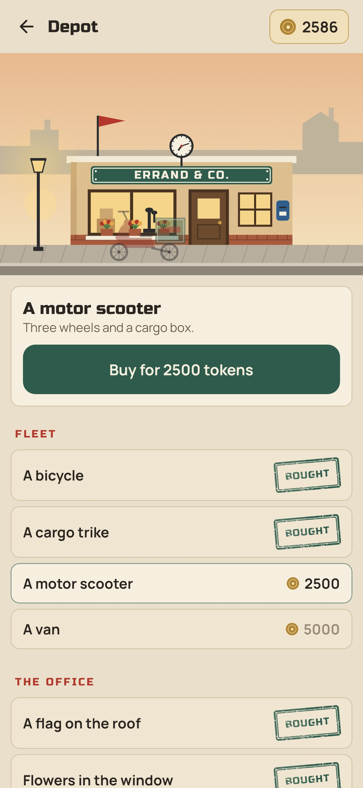
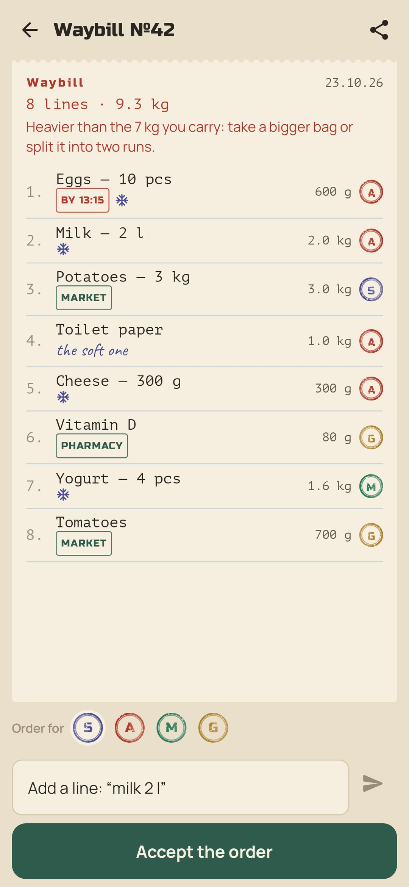

<div align="center">


# Errand

### Every shopping trip is a run.

*You run a small courier office, and its only courier is you. The household places orders on the waybill, you take it out on a run, walk the shop in the order things lie on its shelves and bring it all home. Every run pays in brass tokens: a bicycle at the door, an enamel sign over it, a van one day. Free, no ads, no account, no internet.*

[](https://github.com/bigdevwhale/errand/actions/workflows/android.yml)
[](https://github.com/bigdevwhale/errand/releases/latest)


[](LICENSE)

**English** · [Русский](README.ru.md) · [Changelog](CHANGELOG.md)

    

</div>

---

## The idea

Shopping is a chore everybody puts off: a list in a chat, three things forgotten, a second trip for the bread. Errand turns it into a little courier sim that is also a good list. The game is laid over the real job (whose order it is, how heavy the bag gets, where things lie, what it cost) and pays for doing it well.

## How it works

1. **The waybill.** Every line has a client: you, or someone at home, each with a stamp of their own. Type “milk 2 l” and the amount, the weight and the cold box are worked out from a goods catalogue. Share a list from any messenger to Errand and it is put on the waybill line by line; a line starting with “!” (or “urgent”) is a **rush**: home within the hour pays extra.
2. **Accepting the order.** Money for the run (a budget, optional) and the shops on the way. A waybill heavier than you carry gets a warning: take a bigger bag or split it into two runs.
3. **The run.** The waybill is sorted by the shop’s shelves. Each shop **learns its own order** from the way you tick things off, and the cold box goes last. The string bag fills up as you go. Shelf empty? Mark it: the line rides over to the next run without a mark. Picked something up without an order? The first one is the courier’s treat; more come off the pay.
4. **Delivered.** At home, write the receipt and the weather and hand in the waybill. The stamp comes down and the **payslip** counts every line and every kilo, rushes on time, a run with nothing forgotten, a run within budget, rain and snow (+50%), a big run (+50%). Forgotten lines ride over with a red “not delivered”.
5. **The depot.** Tokens buy the office: a flag, flowers in the window, an enamel sign, a lamp that lights up at night, a clock showing the real time, fresh paint, a telephone, a dovecote, a second floor; and at the door a bicycle, a cargo trike, a scooter and a van.
6. **The personnel file.** Seven ranks, from errand runner to director (bigger things in the depot open with them), the record and fourteen badges.
7. **The merchandiser’s notebook.** Prices noted on runs: what went up in the last month and which shop has it cheaper.
8. **The archive.** Every waybill with its payslip, and a report for each month: runs, kilos, receipts, money left over from budgets.

## Privacy

No account, no ads, no analytics, no permissions at all: no internet, no location, no notifications. Lists come in only when you share them. Everything stays on the phone.

## Building

```bash
./gradlew testDebugUnitTest assembleDebug              # app.errand.dev, next to a real install
./gradlew assembleDebug -Pdemo                         # app.errand.demo, four months of runs made by the real engine
./gradlew testDebugUnitTest -Prender --tests '*RenderArt*' && python tools/shots.py   # screenshots
python tools/icon.py                                   # the logo
python tools/res.py                                    # theme and the launcher icon
```

Kotlin, Jetpack Compose, Room, DataStore. Everything is drawn in code: the office in its street with the sky by the hour, every upgrade and vehicle, the rubber stamps with their worn ink, the string bag, the rank badges.

## License

[MIT](LICENSE). Fonts: Russo One, PT Mono, Manrope and Caveat, all under the SIL Open Font License.
