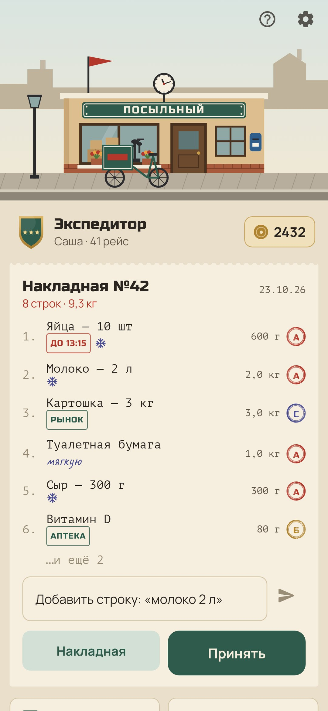
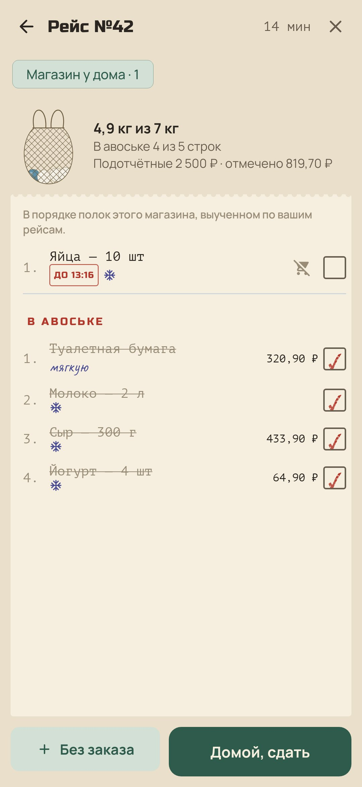
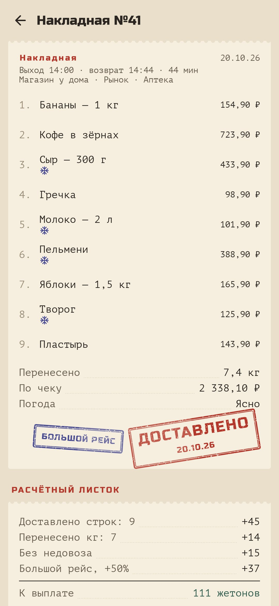
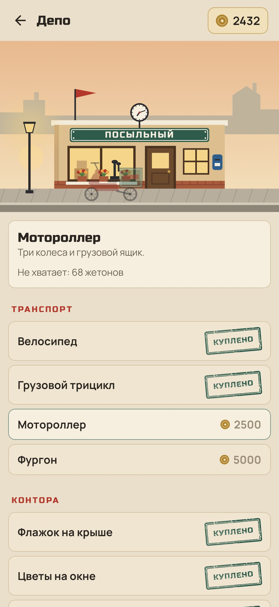
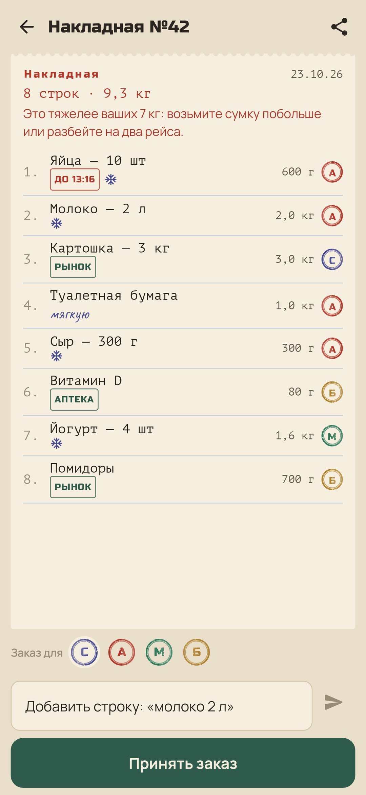

<div align="center">


# Посыльный

### Каждый поход в магазин — рейс.

*Вы держите маленькую курьерскую контору, и единственный курьер в ней — вы. Домашние оставляют заказы в накладной, вы берёте её в рейс, проходите магазин в том порядке, в каком лежит товар, и доставляете всё домой. За каждый рейс контора платит латунными жетонами: велосипед у дверей, эмалевая вывеска, однажды и фургон. Бесплатно, без рекламы, аккаунта и интернета.*

[](https://github.com/bigdevwhale/errand/actions/workflows/android.yml)
[](https://github.com/bigdevwhale/errand/releases/latest)


[](LICENSE)

[English](README.md) · **Русский** · [История изменений](CHANGELOG.md)

    

</div>

---

## Идея

Поход в магазин — дело, которое все откладывают: список в чате, три вещи забыты, за хлебом идти второй раз. «Посыльный» превращает его в маленький симулятор курьера, который заодно оказывается хорошим списком покупок. Игра наложена на настоящую работу (чей заказ, сколько весит авоська, где что лежит, сколько стоило) и платит за то, что она сделана хорошо.

## Как это работает

1. **Накладная.** У каждой строки есть заказчик: вы или кто-то из домашних, у каждого свой штамп. Впишите «молоко 2 л», и количество, вес и термобокс определятся по каталогу товаров. Список можно отправить в «Посыльного» из любого мессенджера, и он разложится в накладной по строкам. Строка с «!» (или «срочно») — **молния**: если доставить её в течение часа, будет надбавка.
2. **Приём заказа.** Подотчётные (бюджет, по желанию) и магазины по пути. Если накладная тяжелее, чем вы носите, будет предупреждение: возьмите сумку побольше или разбейте на два рейса.
3. **Рейс.** Накладная выстраивается по полкам магазина. Каждый магазин **запоминает свой порядок** по тому, как вы отмечаете товары, а холодное идёт последним. Авоська наполняется по ходу рейса. Нет на полке? Отметьте, и строка без пометки переедет в следующий рейс. Взяли что-то не по накладной? Первое — гостинец курьеру, за следующие удерживают из жалованья.
4. **Доставлено.** Дома впишите сумму чека и погоду и сдайте накладную. Падает штамп, а **расчётный листок** учитывает каждую строку и каждый килограмм, молнии вовремя, рейс без недовоза, рейс в пределах подотчётных, дождь и снег (+50%), большой рейс (+50%). Забытые строки переезжают дальше с красным «недовоз».
5. **Депо.** На жетоны обустраивается контора: флажок, цветы на окне, эмалевая вывеска, фонарь, который загорается вечером, часы с настоящим временем, свежая краска, телефон, голубятня, второй этаж. А у дверей появляются велосипед, грузовой трицикл, мотороллер и фургон.
6. **Личное дело.** Семь званий, от посыльного до директора конторы (с ними в депо открываются покупки крупнее), послужной список и четырнадцать знаков отличия.
7. **Товаровед.** Цены, отмеченные в рейсах: что подорожало за последний месяц и в каком магазине дешевле.
8. **Архив.** Все накладные с расчётными листками и отчёт за каждый месяц: рейсы, килограммы, чеки, сэкономленное от подотчётных.

## Приватность

Без аккаунта, рекламы и аналитики, вообще без разрешений: ни интернета, ни геолокации, ни уведомлений. Списки попадают в приложение, только если вы сами ими поделились. Всё хранится на телефоне.

## Сборка

```bash
./gradlew testDebugUnitTest assembleDebug              # app.errand.dev, рядом с настоящей установкой
./gradlew assembleDebug -Pdemo                         # app.errand.demo, четыре месяца рейсов, сделанных настоящим движком
./gradlew testDebugUnitTest -Prender --tests '*RenderArt*' && python tools/shots.py   # скриншоты
python tools/icon.py                                   # логотип
python tools/res.py                                    # тема и иконка
```

Kotlin, Jetpack Compose, Room, DataStore. Всё нарисовано в коде: контора на своей улице с небом по часам, каждое улучшение и каждый транспорт, резиновые штампы со стёртой краской, авоська, нашивки званий.

## Лицензия

[MIT](LICENSE). Шрифты: Russo One, PT Mono, Manrope и Caveat, все под SIL Open Font License.
